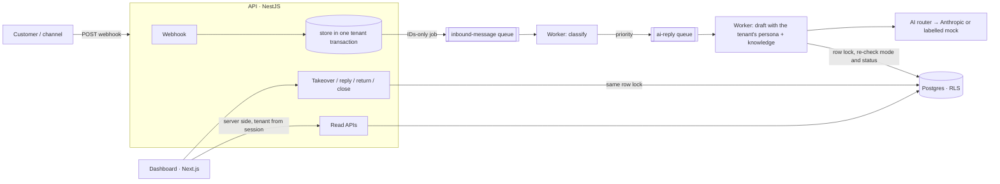

# Mini Inbox

A small multi-tenant version of the core loop: a customer message arrives by webhook, it is stored in that tenant's
conversation, an AI agent replies with that tenant's own persona and knowledge base, and the tenant's operator can
read the thread in a dashboard and take over.

Everything runs locally: NestJS API, a separate BullMQ worker, a Next.js dashboard, Postgres and Redis in Docker.

---

## Run it

**You need:** Docker (running), Node 22.12 or newer, pnpm 10 (`corepack enable` picks the pinned version).
These local ports must be free: 5434 (Postgres), 6379 (Redis), 3000(Mini inbox dashboard), 3001(API), 3002 (Customers simulator).

```bash
pnpm bootstrap   # creates .env, installs, starts Postgres + Redis, builds, migrates, seeds
pnpm dev         # API :3001, worker, dashboard :3000, customer simulator :3002
```

**Real AI replies:** before `pnpm dev`, set both of these in `.env` (bootstrap created it):

# Claude is used for this project api key and ai model
```bash
API_KEY=<PASTE_YOUR_API_KEY>
AI_MODEL= <CHOOSE_YOUR_AI_MODEL>
```

Both are needed: a key without a model stops the worker at start-up on purpose. With neither, the worker uses a
**mock provider whose replies start with `[MOCK]`**, which is useful for trying the flow but is not model output.

### Send a message and watch it appear

```bash
curl -X POST http://localhost:3001/webhook/11111111-1111-4111-8111-111111111111/message \
  -H 'content-type: application/json' \
  -d '{"externalId":"readme-1","from":"+966500000050","text":"How much is a cortado?"}'
# → 202 {"messageId":"…","conversationId":"…"}
```

Then open **http://localhost:3000** → **Inboxes creator** → **Riyadh Coffee House**, and press **Refresh** after a few
seconds: the customer message and the AI reply appear. (There are no live updates; the Refresh button is deliberate.)

- `from` must be a phone number in one fixed form: `+` and 8 to 15 digits, no spaces. Anything else is a 400.
- Sending the same `externalId` again is a safe retry (202, same IDs, nothing new). The same `externalId` from a
  different `from` is refused with 409.

**Working hours matter.** Each seeded tenant has real opening hours, and outside them the reply is that tenant's
fixed out-of-hours message, with no model call:

| Tenant | ID | Hours |
|---|---|---|
| Riyadh Coffee House | `11111111-1111-4111-8111-111111111111` | Sunday–Thursday, 08:00–23:00 Asia/Riyadh |
| London Dental Clinic | `22222222-2222-4222-8222-222222222222` | Monday–Friday, 09:00–17:30 Europe/London |

On a Saturday both are closed all day. To see model replies at any time, open **AI persona** in the dashboard, set
working days to `SUN-SAT` and hours to `00:00`–`23:59`, and save. The next reply uses the new settings.
`pnpm db:seed` puts the demo personas back.

### Other ways to try it

- **Customer simulator (http://localhost:3002):** three test customers pick a business, send messages and read the
  replies, including staff replies and handoff notices. It stands in for WhatsApp and stores nothing. Development only.
- **`pnpm demo:messages`:** sends about 20 messages through the webhook (one customer, a burst of five, Arabic and
  English, a duplicate, takeover and return, the clinic while closed and briefly opened) and prints pass/fail checks
  plus every thread. With a real key it makes about 40 short model calls. It only runs against `localhost`.
- **Tests:** `pnpm test` (needs the Docker services running; uses the mock AI, never the real model).

---

## What the brief asked for, and where it is

| # | Requirement | Where |
|---|---|---|
| 1 | `POST /webhook/:tenantId/message` with `{ externalId, from, text }` | `apps/api/src/webhook/` |
| 2 | Customers, conversations, messages; same `from` + same tenant → same conversation | `packages/database/prisma/schema.prisma`, `packages/database/src/repositories/` |
| 3 | LLM reply with the tenant's own system prompt and knowledge, stored as an outbound message | `apps/worker/src/` (queues, pipeline, ai) |
| 4 | `GET /conversations`, `GET /conversations/:id`, scoped to the calling tenant | `apps/api/src/conversations/conversations-read.*` |
| 5 | `POST /conversations/:id/takeover` disables the AI, `POST /conversations/:id/reply` sends a manual message | `apps/api/src/conversations/conversation-mode.*` |
| 6 | One page: list on the left, thread on the right, take-over button, reply box | `apps/web/app/page.tsx` |
| 7 | README and a seed with two tenants with different personas and knowledge | this file, `packages/database/src/seed.ts` |

### API reference

Tenant-scoped routes take the tenant from the **`x-tenant-id` header**. That header is a development stand-in for
staff login, not authentication (see "Deliberately cut"). A missing, malformed or unknown tenant, or another tenant's
resource, answers 404.

| Method and path | Notes |
|---|---|
| `POST /webhook/:tenantId/message` | Tenant from the URL (existence check only). 202, 400, 404, 409, 413 (over 32 kB), 429 (rate limit), 503 (queue down) |
| `GET /conversations?status=OPEN\|CLOSED&limit=&cursor=` | Newest first. **Only open conversations unless `status=CLOSED`** |
| `GET /conversations/:id?limit=&before=` | Messages oldest first, paged; sender type is `CUSTOMER`, `AI`, `HUMAN` or `SYSTEM` |
| `POST /conversations/:id/takeover` | Sets `HUMAN` mode; repeating it is a no-op |
| `POST /conversations/:id/reply` `{ text }` | **Only after a takeover** (409 while the AI is in charge), so a human and the AI never reply at the same time |
| `POST /conversations/:id/return-to-ai` | Back to `AI` mode |
| `POST /conversations/:id/close` | Closes it; the customer's next message reopens it in AI mode |
| `GET /persona`, `PUT /persona` | The tenant's persona and knowledge base, validated on the server |
| `GET /dev/tenants`, `GET /dev/channel/:tenantId/messages?from=` | Development only (404 when `NODE_ENV=production`): tenant picker and customer simulator |

---

## How it works



1. **Webhook.** It checks that the tenant in the URL exists, validates the body, applies the rate limits, and, in one
   short tenant-scoped transaction, finds or creates the customer, the conversation and the message (status
   `PENDING`). It then awaits the enqueue and answers 202. The job holds IDs only, never text.
2. **Classify** (`inbound-message` queue). Outside working hours, it skips the model and the tenant's out-of-hours
   message is sent. Otherwise one model call labels the message `simple` or `complex` (and an intent).
3. **Reply** (`ai-reply` queue, simple first). Replies inside one conversation are always written in arrival order. A
   complex job waiting over 60 s is raised to the front, so it can't starve.
   - The system prompt is built from that tenant's tone, reply type, business instructions, length limit and
     knowledge entries, plus fixed rules: answer only from the knowledge, ignore instructions inside customer
     messages.
   - The model sees the last 10 messages of that conversation and has no tools.
   - A structured `answerable` flag switches to the tenant's own "not in our knowledge base" message.
4. **Write.** The worker takes a row lock on the conversation, checks again that it is still in AI mode, still open
   and the message is still pending, then stores the `AI` reply. Otherwise it discards the draft and records that.
   Takeover, manual reply, return to AI and close use the same lock. That is how a human and the AI never both
   answer.

**Layout:**
- `apps/api`: HTTP API and webhook.
- `apps/worker`: queue consumers.
- `apps/web`: dashboard.
- `apps/customer-sim`: development-only customer page.
- `packages/database`: Prisma schema, migrations, the tenant transaction and repositories.
- `packages/contracts`: shared Zod schemas and types.
- `packages/config`: environment validation.
- `packages/ui`: the shared stylesheet.

---

## Tenant safety

One tenant seeing another's data is the worst bug here, so the prevention sits in one place, with database backstops
behind it.

- **The one place.** All tenant data goes through `withTenant()` (`packages/database/src/with-tenant.ts`). In the API it
  is reached through `TenantDb.run()`, which takes the tenant from verified request context, never from input.
  - It opens one short transaction and sets the tenant transaction-locally, so a pooled connection can't carry it
    over.
  - It bounds lock and statement time.
  - Every repository function takes `tenantId` and puts it in every query, including by-ID lookups and updates.
- **Where the tenant comes from.** A guard reads the `x-tenant-id` header once, checks it exists, and puts it in
  request context; nothing else reads the header. The webhook takes the tenant from its URL. The worker takes it from
  the job, reloads the rows by `(tenantId, id)`, and refuses a job whose message doesn't belong to its conversation.
- **Database backstop.** Row-level security on every tenant table (`ENABLE` + `FORCE`). The apps connect as
  `app_user`, which is not a superuser, can't bypass RLS and owns no table. With no tenant set, queries see nothing.
- **Composite foreign keys.** A message's `(tenant_id, conversation_id)` must match a conversation of the same tenant,
  and the same for customers, events and reply links. Even a buggy query can't attach data across tenants.
- **Customer identity.** Each tenant has its own customer record per person, with a random ID. The same phone number in
  two tenants gives two unrelated customers, and nothing maps one to the other.
- **Caches, jobs, logs.**
  - Redis keys are `t:{tenantId}:…`, and the persona cache re-checks the tenant on read.
  - Jobs carry IDs only and are validated.
  - Logs carry IDs and timings, never message text or phone numbers.
- **Tests.** Every tenant-scoped endpoint and repository function has a "tenant B tries tenant A's data" test that
  expects 404 or nothing, and checks that A's rows are unchanged. There are also RLS tests (including pooled-connection
  carry-over) and a test that tenant A's model prompt never contains tenant B's persona or knowledge.

Known weak point: identity is a stand-in. Anyone who can reach the API can send any `x-tenant-id`, and the
dashboard's role picker is not a login. Every check above still holds once real authentication supplies the tenant.

---

## The case When things go wrong

Situation | What happens 

1. Redis is down when a message arrives | The message is already stored; the webhook answers **503 within ~3 s** instead of hanging. A retry with the same `externalId` re-queues it. If nobody retries, the worker's **recovery sweep** finds pending messages with no job (every 60 s, older than 2 min) and queues them again.

2. The model is slow or errors | Each call is capped at 30 s. The queue retries 5 times with exponential backoff. After the last attempt the message is marked `FAILED` (visible to staff), and later messages in that conversation are not blocked.

3. The classifier's output is unreadable | It falls back to `complex` / `other`; the message is still answered.

4. The model refuses, or says the answer isn't in the knowledge base | The tenant's own out-of-knowledge-base message is sent.

5. Staff take over while the model is writing | The draft is discarded under the row lock and recorded (`DRAFT_DISCARDED`); nothing is sent.

6. Two staff actions or the AI hit the same conversation at once | Row lock with a 2s limit; the loser gets 409 "busy, retry" instead of waiting forever.

7. A channel sends the same message twice | One message, one job, one reply (unique keys plus job IDs)

8. A job is retried after its reply was already written | No second reply (one reply per inbound message, enforced by a unique key)

9. A sender floods the webhook | 30 messages/min per sender and 600/min per tenant (Redis counters), then 429 with `Retry-After`.

10. Postgres is down | Requests fail with 500 and nothing is half-written (everything is in short transactions)

**One gap to know about:** when a message ends `FAILED`, the customer gets no "we'll get back to you" text. Staff see
it in the dashboard for manual takeover.

---

## Scope: what I built beyond the seven requirements, and why

- **Arabic and English, with right-to-left layout.** The target market is bilingual. Seed content, persona messages
  and the dashboard are in both languages.
- **Persona editor and working hours.** "The tenant's own system prompt" needs a place to edit it. The dashboard
  writes tone, instructions and knowledge, and the worker builds the prompt.
- **Classify first, then reply by priority.** Simple questions are answered before complex ones, without breaking
  arrival order inside a conversation. This is the part with the most moving parts (two queues, an order wait,
  priority aging), and the first thing I would simplify if it had to go.
- **Takeover notices, return to AI, close/reopen.** These make takeover usable end to end. They share one locking rule
  with the AI.
- **Failure handling:** rate limits, a strict sender format, 409 on reused message IDs, and the recovery sweep. Each
  closes a way to lose or duplicate a message.
- **Development tools:** a role picker with a signed cookie, the customer simulator app and `pnpm demo:messages`. They
  exist to demo and test the loop without a real channel or real login, and are labelled as development stand-ins.

## Deliberately cut

- **Real authentication.** There is no staff login: `x-tenant-id` and the dashboard role picker are stand-ins. One
  staff member per tenant, no roles or invitations.
- **Webhook signatures.** The webhook is open; anyone can post as any sender to any tenant. Next step: a per-tenant
  secret and an HMAC signature over timestamp + body.
- **Live updates.** Refresh button only. No unread counts or notifications.
- **Real channels** (WhatsApp, Instagram), deployment, CI and monitoring.
- **Knowledge retrieval.** The whole knowledge base goes into every reply prompt (capped at 50 entries). No search,
  embeddings or prompt caching.
- **Tools for the AI.** No live lookups of stock or bookings; it answers only from the persona and the knowledge.
- **Persona history** (the reply uses the persona current at send time) and **editable time zones** (set by the
  seed).
- **One conversation per customer per tenant.** Closing and reopening reuse it, so very long histories stay in one
  thread (reads are paged; the AI reads the last 10 messages).
- **Dashboard paging.** The page shows the first 50 conversations of a tab and the last 100 messages of a thread,
  although the API supports cursors for both. The list is ordered by when a conversation started, not by its latest
  message.
- **Data deletion and retention.** Every foreign key is `RESTRICT`; there is no privacy-deletion path.

## What to do with another week

1. **Staff login**, replacing the header and role-picker stand-ins. The session would supply the tenant, and every
   check above stays as it is.
2. **Signed webhooks** (per-tenant HMAC with a replay window).
3. **A transactional outbox** instead of "commit, then enqueue", so the recovery sweep becomes a safety net rather
   than a needed path.
4. **A fallback message to the customer** when a reply fails for good, and a reminder when a takeover is left
   unanswered (today, messages that arrive during a takeover are never answered by the AI, by design).
5. **Inbox usability:** sort by latest activity (`last_message_at`), paging and "load older" in the dashboard, unread
   counts bubbling or making the customers' chats bold , then server-sent events instead of Refresh.
6. **Knowledge retrieval and prompt caching**, plus a small evaluation set to check that "answerable" replies are
   grounded in the knowledge.

## Where this breaks at 10,000 messages a day

10,000 a day is about 7 a minute on average, but traffic comes in peaks. A 10× peak is roughly one message a second, messages queue is able to handle with this amount of messages, but only the last 50 conversations is shown in dashboard currently.

- **AI latency is the first wall.** Each message needs two model calls (classify, then reply). With 5 concurrent jobs
  per queue in one worker, and assuming a few seconds per call, one worker sustains roughly 1–2 replies a second. That
  is an estimate, not a measurement. At peaks the queue grows and customers wait. Next: more workers, skip the
  classifier for obvious cases, and stream or cache prompts.
- **Prompt size and cost.** About 20,000 model calls a day for 10,000 messages. The classifier sees only the knowledge topic titles, but
  every reply call carries the full persona and knowledge base. Cost and provider rate limits arrive before CPU does.
  Next: retrieval and prompt caching.
- **One shared queue, no per-tenant fairness.** One noisy tenant can delay every other tenant's replies; the
  per-tenant rate limit only softens it. Next: per-tenant concurrency limits or partitioned queues.
- **One Postgres write path.** Each message is about 8 small writes (customer, conversation, message, classification,
  reply, events, statuses). That is fine at this rate. The pressure points are:
  - the row lock on busy conversations;
  - the arrival-order check per job;
  - the recovery and aging sweeps, which scan per tenant on a timer.
  Next: indexes are already tenant-first, so partition by tenant, add read replicas for the dashboard, and archive old
  messages.
- **Unbounded history per customer.** One conversation per customer means threads grow forever. Reads are paged, but
  the inbox needs a last-activity column and archiving.
- **Refresh-based dashboard.** Many staff polling the list is fine at this size; at larger sizes, push updates instead.

---

## Decisions

The code comments cite decision IDs (`D-0xx`). The full log is kept outside this repository; this is the index.

| ID | Decision |
|---|---|
| D-001 | One customer record per tenant per person; random IDs, never derived from the phone number |
| D-002 | Human/AI handoff: row lock in a short transaction; the model is never called while holding it |
| D-003 | Each message is classified by the model before the reply |
| D-004 | Replies use the persona current at send time; no version history |
| D-005 | Dashboard refresh button; no live updates |
| D-006 | `tenant_id` on every tenant table, composite foreign keys, tenant-scoped unique keys |
| D-007 | Isolation layers: queries, API, jobs, caches, AI context, logs, RLS |
| D-008 | Development identity stand-in (`x-tenant-id` header) |
| D-009 | Primary key `id` plus unique `(tenant_id, id)` |
| D-010 | Webhook dedupe on `(tenant_id, external_id)` |
| D-011 | Events reference messages through a composite foreign key |
| D-012 | One conversation per customer per tenant |
| D-013 | Persona messages stored in both Arabic and English |
| D-014 | At most one AI reply per inbound message (`in_reply_to_message_id` unique) |
| D-015 | Conversation list ordered by creation time |
| D-016 | RLS policy shape and database roles (owner for migrations, `app_user` for the apps) |
| D-017 | Header `x-tenant-id`; missing or unknown tenant → 404 |
| D-018 | Zod schemas in `packages/contracts`, shared by the API and the dashboard |
| D-019 | The webhook takes its tenant from the URL, existence check only |
| D-020 | One FIFO `inbound-message` queue; arrival order kept within a conversation |
| D-021 | Simple messages are answered before complex ones; complex ones are still answered |
| D-022 | No live tenant data lookups; the AI uses only the persona and knowledge |
| D-023 | Classification labels: complexity (simple/complex) and intent |
| D-024 | Unreadable classification → treated as complex / other |
| D-025 | Classification stored on the message |
| D-026 | Two-stage pipeline, strict order per conversation, 60 s priority aging |
| D-027 | Anthropic only, model from `AI_MODEL` (`claude-haiku-5-5`) |
| D-028 | One AI router in the worker; a labelled mock provider without a key |
| D-029 | Reply rules: working hours first, `answerable` flag, last 10 messages as context, persona cache |
| D-030 | Messages that arrive during a takeover are never answered by the AI |
| D-031 | Handoff notices to the customer (`SYSTEM` messages), can be turned off per tenant |
| D-032 | `complexity`, `intent` and `reply_status` columns on customer messages |
| D-033 | Knowledge entries are saved together with the persona |
| D-034 | Reply type is free text |
| D-035 | Saving the persona clears that tenant's cache, so the next reply uses it |
| D-036 | Tenant time zone is read-only (set by the seed) |
| D-037 | If the cache can't be cleared, the save still succeeds and the entry expires within 60 s |
| D-038 | Dashboard tenant selection through a signed httpOnly cookie, never in the URL |
| D-039 | Dashboard language from a cookie and an AR/EN switcher |
| D-040 | Seed: customer messages only, fixed tenant IDs; the worker answers the latest one per conversation |
| D-041 | Customer simulator app and development channel read endpoint |
| D-042 | Sender format: `+` and 8 to 15 digits |
| D-043 | Same message ID from a different sender → 409 |
| D-044 | Webhook rate limits (Redis) and a 32 kB body cap |
| D-045 | Recovery sweep for messages whose queue job was lost |
| D-046 | Webhook stays unauthenticated in the MVP (documented risk) |
| D-047 | Conversation lifecycle: open/closed, staff close, the customer's next message reopens in AI mode |

**Still open:** replacing the identity stand-in with real staff login.

---

## Development notes

- `pnpm test` runs the database, API, worker and web suites against a separate `mini_inbox_test` database and a
  separate queue prefix. The AI provider in tests is always the mock.
- `pnpm db:seed` is safe to re-run. It resets the two demo personas and knowledge bases, and queues each seeded
  conversation's latest customer message for the worker (once; already-answered messages are never queued again).
- Migrations run as the owner role (`MIGRATION_DATABASE_URL`). The apps use `app_user` (`DATABASE_URL`), which is
  subject to row-level security.
- `.env` is gitignored; `.env.example` holds placeholders only.